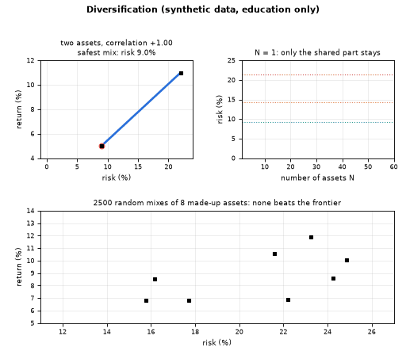
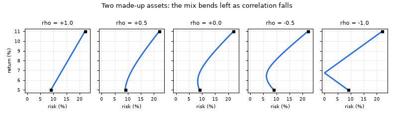
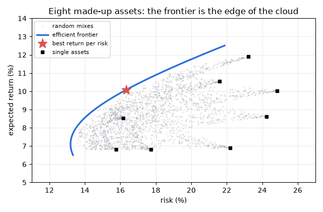

# What you are building toward

A three-panel animation. Top left: the risk-return curve of a mix of two made-up assets bends towards the left axis as their correlation slides from +1 to -1, until the safest mix has no risk at all. Top right: the risk of a portfolio of N assets falls with N and then flattens at a floor that rises when correlations rise. Bottom: a cloud of random mixes of eight made-up assets, with the efficient frontier drawn along its edge and the best return-per-risk mix marked. Your goal over the coming sessions: build that frontier yourself and learn how far to trust it. All data are synthetic; this is education, not advice.

*Target: correlation bends the curve, risk meets a floor, the efficient frontier appears (synthetic data)*

*Two made-up assets: the risk-return curve of the mix for five correlations*

*Eight made-up assets: random mixes and the efficient frontier along their edge*

These results come from a private reference build. The code is not published; the roadmap shows the path so you can build your own.

Live links:

- [Math Visual Studio: probability (Atlas S24)](https://krunalpanchal1995.github.io/studio/#atlas?ch=S24&ex=1)
- [Math Visual Studio: uncertainty quantification (Atlas S27)](https://krunalpanchal1995.github.io/studio/#atlas?ch=S27&ex=1)
