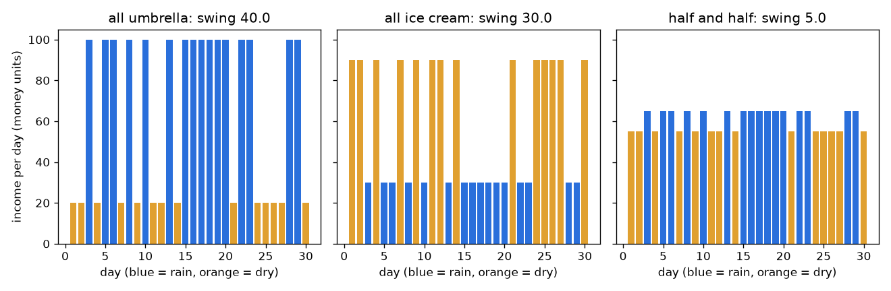
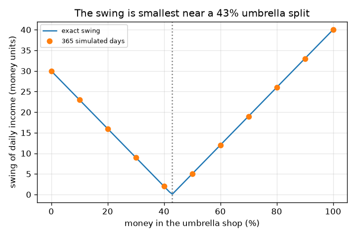

# Session 1: Do not put all your eggs in one basket

*Level 1 (conceptual interactive model) · about 60 minutes · openportfolio*

> This is a simplified educational model. It is not a validated design tool and must not be used for real structures, electrical installations, vehicles, industrial processes or medical decisions.

**Prerequisites**

- Average of a list of numbers, and reading a line graph.
- You have read PRIMER.md and run `python start.py 1` once.

**Learning objectives.** After this session you can:

- Explain, with two shops, why combining things that move in opposite ways gives a steadier total.
- Compute the average and the swing (standard deviation) of a daily income.
- Find the split of money that makes the income steadiest.
- Read a graph of the swing against the split.

## A. Real-world problem
You have some savings to put into a small business. One shop sells umbrellas, the other ice cream. On rainy days the umbrella shop earns a lot and the ice cream shop little; on dry days it is the other way round. Put everything in one shop and your income jumps with the weather. Put some in each and the two shops cover for each other. How much steadier does it get, and what is the best split? This is a toy model for learning, general education only, not investment advice: the shops and incomes are made up, and real markets do not behave like a coin flip of weather.

## B. Concept and theory
Each day is rainy with chance p = 0.5 or dry. With all the money in the umbrella shop the income is 100 on a rainy day and 20 on a dry day; with all the money in the ice cream shop it is 30 and 90 (made-up money units per day). If a fraction f of the money goes into the umbrella shop and 1 - f into the ice cream shop, the income is the same split of the two: f times the umbrella income plus (1 - f) times the ice cream income. The average income is the average over the days. The swing is the standard deviation: the typical distance of a day from the average. Because there are only two kinds of day, the swing is the gap between the rainy-day and dry-day income times the square root of p (1 - p). A small swing means a steady income.

| Symbol | Meaning | Unit |
|---|---|---|
| f | fraction of the money in the umbrella shop | no unit (0 to 1) |
| p | chance that a day is rainy | no unit (0 to 1) |
| R, D | income on a rainy day, on a dry day | money units per day |
| average | average daily income | money units per day |
| swing | standard deviation of the daily income | money units per day |

**Assumptions**

- All numbers are made up; this is a learning model, not investment advice, and the past does not predict the future.
- Days are independent and the rain chance does not change.
- Income is proportional to the money put in, with no costs or taxes.

$$ R(f)=100f+30(1-f),\qquad D(f)=20f+90(1-f) $$

$$ \text{average}=pR+(1-p)D,\qquad \text{swing}=|R-D|\sqrt{p(1-p)} $$

$$ \text{swing}=|70f-30|\quad(p=0.5),\qquad \text{zero swing at } f=\tfrac{3}{7} $$

## C. Visual explanation
The first figure shows 30 days of income for three choices: all umbrella, all ice cream, and half and half. Blue bars are rainy days, orange bars are dry days. The two single-shop charts jump between low and high bars (swings 40.0 and 30.0 in the 365-day simulation), while the half-and-half chart is almost flat (swing 5.0). The second figure plots the swing against the percentage in the umbrella shop: a V shape that touches zero at about 43 percent, with simulated dots sitting on the exact curve.

*30 days of income: one shop jumps between low and high; half and half is almost flat.*

*Swing against split: exact V-shaped curve and simulated dots, zero near 43 percent.*

## D. Interactive simulation
Run the lesson (`python start.py 1`), then open the live app: [Session 1: two shops, one income](https://krunalpanchal1995.github.io/openportfolio/session-01/) (or `app.html` in this folder). Drag the split slider and watch the rainy-day and dry-day bars of your mix move towards each other, then open the swing graph and find the bottom of the V. Change the rain chance and see that the bottom stays at the same split.

**Challenge.** Choose a split so that the swing is at most 5 money units per day (at a rain chance of 50 percent).

## E. Worked example and experiment
**Problem.** Put half the money in each shop. Find the income on a rainy day and on a dry day, the average income and the swing.

1. Rainy day: 0.5 * 100 + 0.5 * 30 = 65 money units.
2. Dry day: 0.5 * 20 + 0.5 * 90 = 55 money units.
3. Average = 0.5 * 65 + 0.5 * 55 = 60 money units per day (the same as either shop alone).
4. Swing = |65 - 55| * sqrt(0.5 * 0.5) = 10 * 0.5 = 5 money units per day.
5. Compare: all umbrella has swing |100 - 20| * 0.5 = 40 and all ice cream has |30 - 90| * 0.5 = 30.

**Answer.** Half and half gives 65 on a rainy day, 55 on a dry day, average 60 and swing 5, against swings of 40 and 30 for a single shop. The checkpoint also confirms it with 365 seeded days: 189 rainy days and swings 40.0, 30.0 and 5.0.

**Experiment.** Hands-on version: toss a coin 30 times (heads = rain). Write the two shop incomes for each toss, add half of each, and compare how much your 'one shop' and 'half and half' columns vary. Real businesses differ from the model: days are not independent (rainy seasons exist), the incomes are not exactly opposite, and shops have costs. So the real swing will not fall to 5, only to something smaller than with one shop.

## F. Assessment and design challenge
**Question type A: Conceptual.** Why does putting money in both shops make the income steadier, even though each shop is unsteady?

Hint

Look at what each shop earns on a rainy day and on a dry day.

Step-by-step solution

The two shops are unsteady in opposite directions: when one earns a lot, the other earns little. Adding them makes the high days of one cover the low days of the other, so the total stays close to the same number. This only works because they move in opposite ways; two umbrella shops would rise and fall together and give no benefit.

**Question type B: Numerical.** Put 25 percent of the money in the umbrella shop. Find the rainy-day income, the dry-day income, the average and the swing (rain chance 0.5).

Hint

R = 100 f + 30 (1 - f) and D = 20 f + 90 (1 - f) with f = 0.25.

Step-by-step solution

R = 25 + 22.5 = 47.5 and D = 5 + 67.5 = 72.5 money units. Average = 0.5 * 47.5 + 0.5 * 72.5 = 60. Swing = |47.5 - 72.5| * 0.5 = 12.5, which matches |70 * 0.25 - 30| = 12.5. Sanity check: it lies between 5 (half and half) and 30 (all ice cream).

**Question type C: Graph and simulation interpretation.** In the graph of swing against split, where is the swing zero and what are the swings at 0 and at 100 percent? What does the V shape mean on each side of the bottom?

Hint

Set R = D, or read the bottom of the V.

Step-by-step solution

The swing is zero at f = 3/7 = 42.9 percent, where R = D. At 0 percent (all ice cream) it is 30 and at 100 percent (all umbrella) it is 40. Left of the bottom the ice cream shop dominates and the income is higher on dry days; right of the bottom the umbrella shop dominates and it is higher on rainy days. Either side, the swing grows because one shop's pattern wins.

**Question type D: Design and optimisation challenge.** Design: you want the swing to be at most 10 money units per day. Which splits work? Why might you not choose exactly the zero-swing split?

Hint

Solve |70 f - 30| <= 10.

Step-by-step solution

f must be between 2/7 = 28.6 percent and 4/7 = 57.1 percent. The zero-swing split 42.9 percent is the steadiest, but it depends on the made-up numbers being exactly right. If the shops' incomes or the rain chance change, the best split moves, so a split in the middle of the band is a safer choice. Trade-off: the average stays 60 for every split here, so steadiness is free; in real life lower risk often costs some average return (Session 2).

Score yourself with [RUBRIC.md](../../RUBRIC.md). Print the [activity sheet](activity_sheet.md) to work on paper.

## Common misconceptions
| Common misconception | What is actually true |
|---|---|
| Splitting the money lowers the average income. | Here the average is 60 for every split, because the shops have the same average. Diversifying changes the swing; it only changes the average when the assets have different averages (Session 2). |
| Two shops are always steadier than one. | Only if they do not move together. Two umbrella shops rise and fall together, so splitting between them leaves the swing unchanged. |
| The swing is the biggest loss you can have. | The swing (standard deviation) is a typical distance from the average, not a worst case. A bad day can be further away. |
| A model with made-up numbers tells you what will happen. | It shows how an idea works. Real incomes and real markets are not known in advance, and past results never predict the future. |

## Glossary
- **average (mean)**: the sum of the daily incomes divided by the number of days
- **swing (standard deviation)**: the typical distance of a day from the average; small means steady
- **split**: the fraction of the money put into each shop
- **diversification**: spreading money over things that do not move together, so that the total is steadier
- **seed**: a number that makes a random generator repeat the same numbers every time

## Finish
1. Do the three coding tasks in [exercises.md](exercises.md).
2. Run `python start.py 1` again after your changes. It ends with the checkpoint; when it prints `PASS`, you are done. (Checkpoint only: `python start.py check 1`.)

Next: [Session 2](../session-02/README.md)
