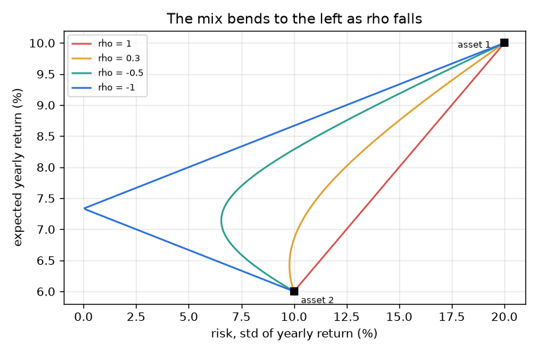
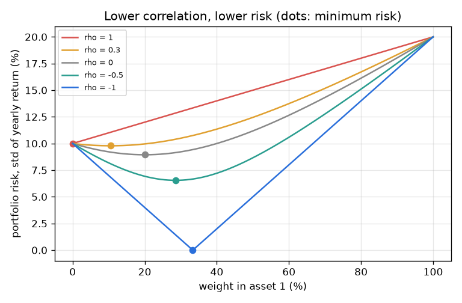

# Session 2: Return, risk and correlation of two assets

*Level 2 (mathematical engineering model) · about 75 minutes · openportfolio*

> This is a simplified educational model. It is not a validated design tool and must not be used for real structures, electrical installations, vehicles, industrial processes or medical decisions.

**Prerequisites**

- Session 1: average and swing.
- Algebra: expanding (a + b)^2 and solving a linear equation.

**Learning objectives.** After this session you can:

- Measure the mean return and the risk (standard deviation) of a simulated asset.
- Use the two-asset formulas for expected return and variance, and verify them on sampled portfolios.
- Explain what correlation does: no benefit at +1, risk that can vanish at -1.
- Derive and check the minimum-variance weight, and solve a small design problem.

## A. Real-world problem
Session 1 had shops that were exactly opposite. Real assets are only partly opposite, so we need numbers: what an asset earns on average (mean return), how much it wobbles (standard deviation, our measure of risk) and how much two assets move together (correlation rho, between -1 and +1). Then the question: how should we split money between two assets to get the least risk, or the best risk for a return we want? All assets here are synthetic and their returns made up (asset 1: mean 10 percent, risk 20 percent; asset 2: mean 6 percent, risk 10 percent per year). This is general education, not investment advice, and a model like this does not predict real markets.

## B. Concept and theory
Yearly returns are drawn from a seeded generator: r1 = mu1 + s1 z1 and r2 = mu2 + s2 (rho z1 + sqrt(1 - rho^2) z2), where z1 and z2 are independent bell-curve numbers. The means are mu1, mu2, the risks (standard deviations) are s1, s2 and the correlation is rho. With weight w in asset 1 and 1 - w in asset 2, the expected return is a weighted average, but the variance has a cross term that depends on rho. For rho = 1 the variance is (w s1 + (1 - w) s2)^2, so risk is just the weighted average of the risks: no benefit. For rho = -1 it is (w s1 - (1 - w) s2)^2, which is zero at w = s2 / (s1 + s2). The weight with the least variance comes from setting the derivative to zero. For other inputs it can fall outside 0 to 1, which would mean borrowing or short selling.

| Symbol | Meaning | Unit |
|---|---|---|
| mu1, mu2 | mean (expected) yearly return of each asset | fraction per year (0.10 = 10%) |
| s1, s2 | risk: standard deviation of the yearly return | fraction per year |
| rho | correlation of the two returns | no unit, from -1 to 1 |
| w | weight (fraction of money) in asset 1 | no unit |
| w* | weight with the least variance | no unit |

**Assumptions**

- Returns are bell-curve (normal) draws with fixed means, risks and correlation: a simplification, real returns have fatter tails.
- Both assets are synthetic with made-up numbers; this is not investment advice.
- Weights are between 0 and 1 (no short selling, no borrowing), except when we discuss w* outside that range.
- No trading costs or taxes; past results do not predict the future.

$$ E[R_p]=w\mu_1+(1-w)\mu_2 $$

$$ \sigma_p^2=w^2\sigma_1^2+(1-w)^2\sigma_2^2+2w(1-w)\rho\sigma_1\sigma_2 $$

$$ \rho=-1:\ \sigma_p=|w\sigma_1-(1-w)\sigma_2|=0\ \Rightarrow\ w=\frac{\sigma_2}{\sigma_1+\sigma_2} $$

$$ w^*=\frac{\sigma_2^2-\rho\sigma_1\sigma_2}{\sigma_1^2+\sigma_2^2-2\rho\sigma_1\sigma_2} $$

## C. Visual explanation
The first figure plots the portfolio risk against the weight in asset 1 for several correlations, with a dot at the minimum of each curve. For rho = 1 the curve is a straight line from 10 percent to 20 percent, so mixing helps nothing. For rho = -1 it touches zero at a weight of one third. In between, lower rho means a lower curve. The second figure plots risk (horizontal) against expected return (vertical): the line from asset 2 to asset 1 bends towards the left axis as rho falls, which means the same return with less risk.

*Risk-return curve of the mix; it bends left as correlation falls.*

*Risk against weight for five correlations; dots mark the minimum of each curve.*

## D. Interactive simulation
Run the lesson (`python start.py 2`), then open the live app: [Session 2: two assets, one correlation](https://krunalpanchal1995.github.io/openportfolio/session-02/) (or `app.html` in this folder). Move the weight and correlation sliders. In the first graph watch the blue curve drop as rho falls and the dot slide to the least-risk weight; in the second graph watch the curve bend left. Compare the readout with the formulas.

**Challenge.** Get an expected return of at least 7 percent with a risk of at most 8 percent.

## E. Worked example and experiment
**Problem.** Put half the money in each asset (w = 0.5) with correlation rho = 0.3. Find the expected return, the variance and the risk, and check against a simulated portfolio of 100000 years.

1. Expected return = 0.5 * 0.10 + 0.5 * 0.06 = 0.08, that is 8 percent.
2. Variance = 0.25 * 0.04 + 0.25 * 0.01 + 2 * 0.25 * 0.3 * 0.2 * 0.1 = 0.0100 + 0.0025 + 0.0030 = 0.0155.
3. Risk = sqrt(0.0155) = 0.1245, that is 12.45 percent.
4. Simulation (seed 7, 100000 years, correlation 0.3): the sampled portfolio has mean 0.0800 and risk 0.1245. They agree.
5. Compare with the single assets: 20 percent and 10 percent. The mix has an average return of 8 percent with less than the average of the two risks (15 percent).

**Answer.** Return 8.00 percent, variance 0.0155, risk 12.45 percent; the simulation gives 0.0800 and 0.1245. For the exact version, the checkpoint also shows that the formula is an identity when built from the sample variances and covariance.

**Experiment.** Compare model and reality with free price data of two real, unrelated things (for example the monthly average temperature and the monthly sales of a shop you know): compute their correlation and the variance of their sum. The formula will match the data exactly when built from sample numbers, but the correlation you measure on one year of data will be different from the one in the next year. The model assumes rho is fixed and known; reality does not.

## F. Assessment and design challenge
**Question type A: Conceptual.** Why does a correlation of +1 give no diversification benefit, while a correlation of -1 can remove the risk completely?

Hint

Look at the variance for rho = 1 and rho = -1: each is a perfect square.

Step-by-step solution

For rho = 1 the variance is (w s1 + (1 - w) s2)^2: the two wobbles always point the same way and add, so the risk is only the weighted average of the risks. For rho = -1 it is (w s1 - (1 - w) s2)^2: the wobbles point in opposite directions and subtract, and at w = s2 / (s1 + s2) they cancel exactly, leaving zero variance. Diversification works through the cross term 2 w (1 - w) rho s1 s2.

**Question type B: Numerical.** Assets 1 and 2 are uncorrelated (rho = 0). Find the weight with the least risk, that risk, and the expected return there.

Hint

w* = (s2^2 - 0) / (s1^2 + s2^2) with s1 = 0.20 and s2 = 0.10.

Step-by-step solution

w* = 0.01 / (0.04 + 0.01) = 0.2. Variance = 0.2^2 * 0.04 + 0.8^2 * 0.01 = 0.0016 + 0.0064 = 0.0080, so the risk is 0.0894 (8.94 percent), below both assets' 10 and 20 percent. Expected return = 0.2 * 0.10 + 0.8 * 0.06 = 0.068 (6.8 percent). Sanity check: the weight is small because asset 1 is the riskier one.

**Question type C: Graph and simulation interpretation.** In the first figure, at rho = 0.3 where is the minimum of the risk curve, and is it lower than the risk of the safer asset (10 percent)? What would happen at rho = 1?

Hint

Find the dot of the matching colour and use w*.

Step-by-step solution

At rho = 0.3 the minimum is at w* = 0.1053 (about 10.5 percent in asset 1) with risk 9.79 percent: slightly below the safer asset's 10 percent, so a little of the riskier asset reduces the total risk. At rho = 1 the curve is a straight line, w* = -1 is outside 0 to 1, and the safest mix inside 0 to 1 is all asset 2 (risk 10 percent).

**Question type D: Design and optimisation challenge.** Design: you want an expected return of at least 8 percent and a risk of at most 11 percent from these two assets. What weight do you need and how low must the correlation be? Is rho = 0.3 enough? What can you do if not?

Hint

w = 0.5 gives 8 percent. Solve the variance formula for rho with risk 0.11.

Step-by-step solution

A return of 8 percent needs w = 0.5 (it is a weighted average). With w = 0.5 the variance is 0.0125 + 0.01 rho; setting it to 0.11^2 = 0.0121 gives rho <= -0.04. So the assets must be slightly negatively correlated; rho = 0.3 (risk 12.45 percent) is not enough. Alternatives: accept a lower return, for example 7 percent needs w = 0.25 and gives a risk of 10.19 percent at rho = 0.3; or look for a third asset. Trade-off: return and risk move together, and the assumed rho may not be stable.

Score yourself with [RUBRIC.md](../../RUBRIC.md). Print the [activity sheet](activity_sheet.md) to work on paper.

## Common misconceptions
| Common misconception | What is actually true |
|---|---|
| Mixing two assets averages their risks. | That is only true when rho = 1. For rho below 1 the mix has less risk than the weighted average of the risks. |
| A correlation of 0 means no relationship at all. | It means the returns do not move together in a straight-line way on average; it does not rule out other relationships. |
| The minimum-variance weight always lies between 0 and 1. | It can fall outside (for example w* = -1 at rho = 1 with these assets), which would mean short selling; then the safest allowed mix is at the edge. |
| Diversifying always lowers the return. | The expected return is just the weighted average of the two means. A mix has less return than the best asset, but risk can fall faster than return. |
| The model tells you what to buy. | It is a teaching model with made-up numbers. It is not investment advice. |

## Glossary
- **mean return**: the average of the returns; the model's expected return
- **standard deviation (risk)**: typical distance of a return from its mean; here our measure of risk
- **variance**: the standard deviation squared
- **correlation (rho)**: a number from -1 to 1 for how much two returns move together
- **weight**: the fraction of the money put in an asset
- **short selling**: a negative weight: borrowing an asset to sell it

## Finish
1. Do the three coding tasks in [exercises.md](exercises.md).
2. Run `python start.py 2` again after your changes. It ends with the checkpoint; when it prints `PASS`, you are done. (Checkpoint only: `python start.py check 2`.)

Next: [Session 3](../session-03/README.md)
