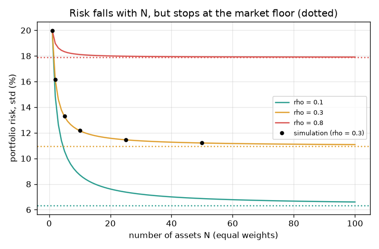
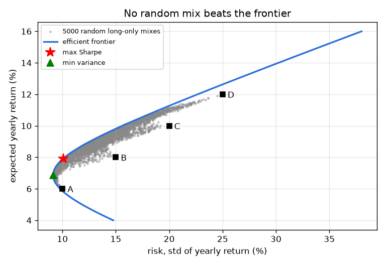
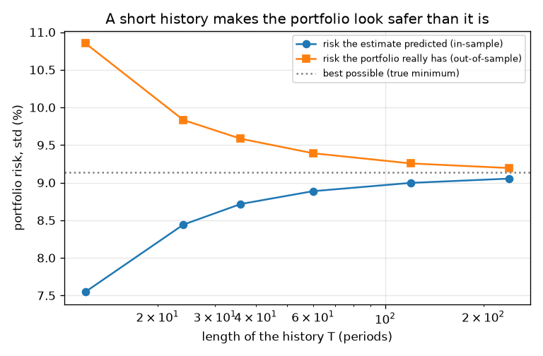

# Session 3: Many assets, the efficient frontier and its limits

*Level 3 (simulation and validation) · about 90 minutes · openportfolio*

> This is a simplified educational model. It is not a validated design tool and must not be used for real structures, electrical installations, vehicles, industrial processes or medical decisions.

**Prerequisites**

- Session 2: portfolio return, variance and correlation.
- Matrices: a matrix times a vector, and the inverse of a matrix (explained as it is used).

**Learning objectives.** After this session you can:

- Show that diversification removes only the idiosyncratic part of risk, not the market part.
- Build a covariance matrix, check it is positive definite, and compute minimum-variance and frontier portfolios.
- Compute the Sharpe ratio and the tangency portfolio, and check against random portfolios.
- Quantify estimation error with a seeded simulation, and explain two failure cases.

## A. Real-world problem
A real portfolio may hold dozens of assets. If I keep adding assets, does my risk go to zero? Among all mixes of several assets, which has the least risk for the return I want, and which gives the best return per unit of risk? And all of this is computed from numbers estimated from a short history: how much should I trust it? Everything here is synthetic (four made-up assets, a made-up risk-free rate), general education only, not investment advice. A model like this does not predict real markets: real returns have fatter tails and correlations change, especially in a crisis.

## B. Concept and theory
For N assets with equal weights 1/N, common risk s and common correlation rho, the variance is s^2 (1/N + (1 - 1/N) rho). The first part, s^2 / N, is the idiosyncratic risk and vanishes as N grows; the second tends to s^2 rho, the market risk shared by all, which no number of assets removes. With several assets, the covariance matrix Sigma holds every variance and covariance and the portfolio variance is w' Sigma w. Minimising it for a target return m with weights summing to 1 has a closed form (Lagrange multipliers); the set of these portfolios is the efficient frontier. The Sharpe ratio (return minus the risk-free rate, divided by risk) is largest for the tangency portfolio with weights proportional to the inverse of Sigma times (mu - rf). The same formulas applied to estimates from a short history give weights that look better in-sample than they really are.

| Symbol | Meaning | Unit |
|---|---|---|
| N | number of assets | no unit |
| s, rho | common risk and correlation (equal-weight case) | fraction per year, no unit |
| mu | vector of mean returns | fraction per year |
| Sigma | covariance matrix (variances on the diagonal) | fraction^2 per year |
| w | vector of weights, summing to 1 | no unit |
| rf | risk-free rate (made up: 0.02) | fraction per year |
| T | number of periods in the history used for estimates | periods |

**Assumptions**

- All assets are synthetic with made-up means, risks and correlations; nothing here is investment advice.
- Returns are normal with fixed means and covariance: a simplification.
- Closed-form weights may be negative (short selling); long-only mixes are a subset and cannot beat the frontier.
- No trading costs or taxes; a model does not predict real markets and past performance does not predict the future.

$$ \sigma_p^2=\sigma^2\left(\frac1N+\Big(1-\frac1N\Big)\rho\right)\ \longrightarrow\ \sigma^2\rho\quad(N\to\infty) $$

$$ A=\mathbf 1^{\mathsf T}\Sigma^{-1}\mathbf 1,\ B=\mathbf 1^{\mathsf T}\Sigma^{-1}\mu,\ C=\mu^{\mathsf T}\Sigma^{-1}\mu,\ D=AC-B^2 $$

$$ w(m)=\Sigma^{-1}(\lambda\mathbf 1+\gamma\mu),\ \lambda=\frac{C-Bm}{D},\ \gamma=\frac{Am-B}{D},\qquad \sigma^2(m)=\frac{Am^2-2Bm+C}{D} $$

$$ \text{Sharpe}=\frac{\mu_p-r_f}{\sigma_p},\qquad w_{\tan}=\frac{\Sigma^{-1}(\mu-r_f\mathbf 1)}{\mathbf 1^{\mathsf T}\Sigma^{-1}(\mu-r_f\mathbf 1)} $$

## C. Visual explanation
The first figure plots portfolio risk against the number of assets for three correlations, with dotted floors at s sqrt(rho): the curves fall steeply at first and then flatten. The second figure shows random long-only mixes of four made-up assets as grey dots, the efficient frontier as a blue curve along the left edge of the cloud, and two marked portfolios: minimum variance and best Sharpe. The third figure plots, against the length of the history, the risk the estimate predicted and the risk the portfolio really has: the real risk is above the prediction, and the gap shrinks as the history grows.

*Risk against N for three correlations: it falls, then flattens at the market floor (dotted); dots are simulated.*

*Random long-only mixes (grey) and the efficient frontier (blue) of four made-up assets.*

*Predicted and true risk of the estimated minimum-variance portfolio against history length.*

## D. Interactive simulation
Run the lesson (`python start.py 3`), then open the live app: [Session 3: how far does diversification go?](https://krunalpanchal1995.github.io/openportfolio/session-03/) (or `app.html` in this folder). Move the number of assets and the correlation. Watch the blue curve flatten at the grey floor, then compare it with the red crisis curve (rho = 0.8). Switch to the variance split to see the own (green) part shrink while the shared (blue) part stays.

**Challenge.** Get the portfolio risk to at most 12 percent.

## E. Worked example and experiment
**Problem.** Four assets, each with risk 0.20 and common correlation 0.3, held with equal weights. Find the portfolio variance and risk, and the limit as the number of assets grows.

1. Variance = 0.04 * (1/4 + (3/4) * 0.3) = 0.04 * (0.25 + 0.225) = 0.04 * 0.475 = 0.0190.
2. Risk = sqrt(0.0190) = 0.1378, that is 13.78 percent, about 31 percent below the 20 percent of one asset.
3. Limit: s * sqrt(rho) = 0.2 * sqrt(0.3) = 0.1095, that is 10.95 percent. Even a million assets stay above it.
4. Check by simulation: 200000 years of one-factor returns give 0.1380 for N = 4 (the formula gives 0.1378).

**Answer.** Variance 0.0190, risk 13.78 percent for N = 4; the floor is 10.95 percent. The checkpoint also reproduces the formula from a covariance matrix.

**Experiment.** Hands-on version: roll one die for the shared (market) part and one die per asset for its own part, and average the totals of N assets over many rounds. The spread of the average shrinks with N but stops at the spread of the shared die. Real markets differ from the model: correlations are not fixed, and in a crisis they rise, so the floor rises just when you need diversification. The frontier from the closed form is exact for the model, but real inputs are estimated and noisy (see the estimation-error figure).

## Real-world application and mini-project: Build a four-asset synthetic portfolio and test it honestly
Here is a made-up asset set B (education only, not advice). Yearly mean returns: 4%, 7%, 9%, 13%. Standard deviations: 8%, 12%, 18%, 30%. Correlations: 0.2 between assets 1 and 2, 0.1 between 1 and 3, 0 between 1 and 4, 0.3 between 2 and 3, 0.2 between 2 and 4, 0.6 between 3 and 4. The risk-free rate is 2%. Use the Session 3 functions to: build the covariance matrix and check it is positive definite; find the minimum-variance weights and the Sharpe-best (tangency) weights using the true numbers; then draw a history of 36 yearly periods (draw_sample with seed 21), estimate from it, and measure how the estimated minimum-variance portfolio really behaves. Repeat over 1000 histories with estimation_experiment(36, 1000, mu, sigma, 21).

**Deliverable:** A script that prints the covariance check, both sets of true weights with their return, risk and Sharpe ratio, the weights estimated from the single seed-21 history, and the in-sample (predicted) and out-of-sample (true) risk averaged over 1000 histories. Add two sentences on why the two risks differ.

**Success looks like:** True minimum-variance weights are 0.7027, 0.2174, 0.0650, 0.0148 (risk 0.0708); Sharpe-best weights are 0.3545, 0.3918, 0.1379, 0.1158 (Sharpe 0.5521); the seed-21 history gives a negative weight (a short position) in asset 4; over 1000 histories the predicted risk averages 0.0669 while the true risk averages 0.0742.

## F. Assessment and design challenge
**Question type A: Conceptual.** Why can you never diversify away all the risk by adding more and more assets, if they share a common correlation?

Hint

Split the variance into the part that shrinks like 1/N and the part that does not.

Step-by-step solution

Each asset's return is a shared (market) part plus its own part. Averaging many assets cancels their own parts (their variance falls like 1/N) but the shared part is the same in every asset, so averaging does not reduce it. The variance tends to s^2 rho, so the risk tends to s sqrt(rho). Only assets with a lower correlation (a different shared part) lower the floor.

**Question type B: Numerical.** Find the variance and risk of an equal-weight portfolio of N = 10 assets with s = 0.20 and rho = 0.3. By what percent is it below the risk of one asset?

Hint

var = s^2 (1/N + (1 - 1/N) rho).

Step-by-step solution

Variance = 0.04 * (0.1 + 0.9 * 0.3) = 0.04 * 0.37 = 0.0148, so the risk is 0.1217 (12.17 percent). The reduction is (0.2 - 0.1217) / 0.2 = 39 percent. Sanity check: it lies between the floor 10.95 percent and the single-asset 20 percent.

**Question type C: Graph and simulation interpretation.** In the estimation-error figure, what is the predicted risk and the true risk for a history of T = 12 periods, and for T = 240? What does the gap tell you?

Hint

Compare the two curves at each T; the dotted line is the best possible risk.

Step-by-step solution

At T = 12 the estimate predicts 0.0753 (7.53 percent) but the portfolio really has 0.1080 (10.80 percent), above the best possible 0.0914 (9.14 percent). At T = 240 they are 0.0906 and 0.0919, nearly equal. The gap shows that optimising on a short history overfits the noise: it picks weights that look safe in-sample but are worse out-of-sample, and more data (or simpler weights) reduces the problem.

**Question type D: Design and optimisation challenge.** Design: with s = 0.20 and rho = 0.3 you want a risk of at most 12 percent using equal weights. How many assets do you need? What if the assets had rho = 0.5? What does that say about a crisis?

Hint

Solve 0.0144 >= 0.04 (1/N + (1 - 1/N) 0.3) for N, and compare 0.12 with the floor.

Step-by-step solution

0.36 >= 0.3 + 0.7 / N gives N >= 11.7, so N = 12: risk 0.1197 (N = 11 gives 0.1206, just too high). With rho = 0.5 the floor is 0.2 * sqrt(0.5) = 0.1414 (14.14 percent), above 12 percent: no number of assets achieves it. In a crisis, correlations rise towards one and the floor rises, so a portfolio that met its target in calm times can miss it exactly when it matters. Trade-off: more assets cost more to hold and monitor.

Score yourself with [RUBRIC.md](../../RUBRIC.md). Print the [activity sheet](activity_sheet.md) to work on paper.

## Common misconceptions
| Common misconception | What is actually true |
|---|---|
| If I hold enough assets, my risk goes to zero. | Only the idiosyncratic part goes to zero. The shared part remains: risk tends to s sqrt(rho), not to 0. |
| The optimal portfolio from my data is the best portfolio. | It is the best for the estimated numbers. Out-of-sample its risk is higher than predicted, and the Sharpe ratio is lower than promised. |
| Correlations stay the same in a crisis. | They tend to rise in a crisis, so the benefit of diversification shrinks when it is needed most. |
| Closed-form weights are always sensible. | When assets are almost copies of each other the covariance matrix is nearly singular and the weights explode into huge long and short positions. |
| More assets are always better. | More assets help only up to the floor, and cost more to hold. |

## Glossary
- **covariance matrix**: a table with every asset's variance on the diagonal and every pair's covariance elsewhere
- **positive definite**: every portfolio has a positive variance; needed for a valid covariance matrix
- **efficient frontier**: the portfolios with the least risk for each target return
- **Sharpe ratio**: extra return over the risk-free rate per unit of risk
- **tangency portfolio**: the portfolio with the highest Sharpe ratio
- **idiosyncratic risk**: risk specific to one asset that averages away
- **market risk**: risk shared by all assets that diversification cannot remove
- **out-of-sample**: measured on the true model or on new data, not on the data used to build the portfolio

## Finish
1. Do the three coding tasks in [exercises.md](exercises.md).
2. Run `python start.py 3` again after your changes. It ends with the checkpoint; when it prints `PASS`, you are done. (Checkpoint only: `python start.py check 3`.)

Next: the [roadmap](../../promo/roadmap.md). Session 4 is yours to build.
